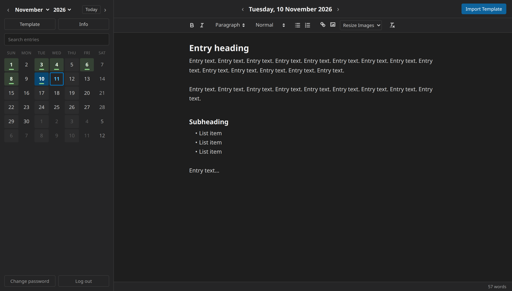

# Self-Hosted Journal

A private, encrypted journal you write in the browser and host yourself.
One entry per day, a calendar to find them, and no cloud service involved.



## Features

- **Calendar** with days that have entries highlighted, and full keyboard navigation
- **Rich text**: headings, lists, links and images. Photos are shrunk and have their location data removed before upload
- **Autosave** that keeps retrying if the connection drops, instead of losing what you typed
- **Several devices at once**: if a page changes elsewhere, you see both copies and choose, rather than one silently overwriting the other
- **Search** across every entry
- **Template** page to start entries from, and an **Info** page for notes
- **Works on phones**
- **Encrypted at rest**: entries and images are encrypted with a key made from your password

## Quick start

The app is a single Docker container, meant to sit behind the reverse proxy
you already use (nginx, Caddy, ...).

1. Add the service from [`server/docker-compose.example.yml`](server/docker-compose.example.yml)
   to your compose file, and point your reverse proxy at `http://journal:8420`.
2. Build and start it:

   ```bash
   docker compose build journal
   ```
   ```bash
   docker compose up -d journal
   ```

3. Open it in your browser and create a password (12 characters or more).

> **There is no password recovery.** Your password is the encryption key. If
> you lose it, your entries can't be read by anyone, including you. Keep it
> in a password manager.

## Configuration

| Variable | Default | Purpose |
|---|---|---|
| `JOURNAL_DATA_DIR` | `/data` in Docker | Where `journal.db` lives. Mount a volume here. |
| `JOURNAL_COOKIE_SECURE` | off | Set to `1` once the site is served over HTTPS. |
| `JOURNAL_PROXY_COUNT` | `0` | How many proxies in front of the app add `X-Forwarded-For` (usually `1`). Lets the login rate limit see real visitor addresses. |

Everything is in one file, `journal.db`, and it's already encrypted, so
backing it up is just copying it. Stop the container first, so you don't
copy it mid-save.

## Security

- Your password is turned into a key with scrypt. Entries and images are
  encrypted with it (Fernet: AES with an integrity check). The password
  itself is never stored.
- The key is held only in the server's memory, for a login that lasts at
  most 2 hours. After that the page locks and asks for the password again.
- Wrong passwords are rate-limited. Other sites can't make changes on your
  behalf (CSRF protection). A strict Content-Security-Policy is in place,
  no third-party code is loaded, and entries aren't left in the browser's cache.
- **Limits:** the server does the decrypting, so anyone who controls the
  server while you're logged in could read your entries. Entry dates and
  sizes are not encrypted.

## Development

```bash
cd server
python3 -m venv venv && source venv/bin/activate
pip install -r requirements-dev.txt
python app.py   # http://127.0.0.1:8420
pytest          # about a second, against throwaway journals
```

| Path | |
|---|---|
| `server/app.py` | Flask server and API |
| `server/db.py`, `server/crypto.py` | Storage and encryption |
| `server/static/js/` | The page's code, as ES modules with no build step (`main.js` lists them) |
| `server/tests/` | pytest suite |

## Licence

[MIT](LICENSE)
